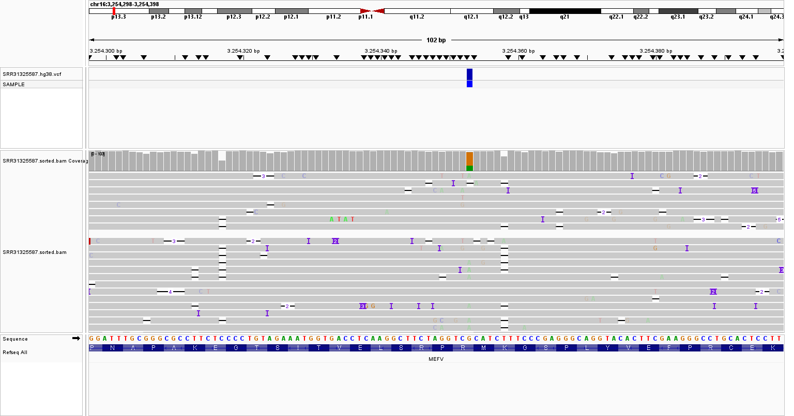

cat > README.md << 'EOF'
# MEFV DNA-seq Variant Analysis Pipeline

Targeted variant analysis of the MEFV gene from Oxford Nanopore (ONT) long-read sequencing data (sample SRR31325587), aligned to GRCh38.

This project is for educational and research purposes only. It cannot be used for clinical diagnosis, screening, or treatment decisions.

## Result

A heterozygous stop-gained variant, c.715C>T (p.Arg239*), was found in MEFV at chr16:3254353 (88X depth). Loss of function is not the established disease mechanism for MEFV, so the variant was classified as a **variant of uncertain significance (VUS)**. The call has limited support (alternate allele fraction 0.34) and needs orthogonal validation, e.g. Sanger sequencing.

Full details: [reports/MEFV_report_EN.md](reports/MEFV_report_EN.md) (English) and [reports/MEFV_report_TR.md](reports/MEFV_report_TR.md) (Turkish).

## Workflow

| Step | Tool | Version |
|---|---|---|
| Data retrieval | SRA Toolkit (prefetch, fasterq-dump) | 3.4.1 |
| Quality control | NanoPlot | 1.47.1 |
| Alignment | minimap2 (-ax map-ont) | 2.30 |
| BAM processing | samtools | 1.23.1 |
| Variant calling | Longshot | 0.4.3 |
| Filtering | bcftools | 1.23.1 |
| Annotation | snpEff (GRCh38.99) | 5.3a |
| Visualization | IGV | - |

Variant files are produced in this order: `SRR31325587.vcf` (Longshot output) -> `.chr.vcf` (only the chr16 name changed) -> `.hg38.vcf` (all chromosome names converted to Ensembl style, see `scripts/chr_map.txt`) -> `.ann.vcf` (snpEff annotation).

## Repository structure

    scripts/       pipeline commands (MEFV_pipeline.sh) and chromosome name map
    variants/      VCF files, snpEff outputs, variant lists
    qc/nanoplot/   NanoPlot quality control reports
    reports/       analysis reports (EN, TR)
    figures/       IGV snapshot
    environment.yml  conda environment

## Not included in the repository

Large files are excluded through `.gitignore`: raw reads (`raw_fastq/`), alignments (`alignment/`) and the reference genome (`reference/`).

## Usage

Create the environment:

    conda env create -f environment.yml

Download the reads and place the GRCh38 reference FASTA at `reference/hg38.fa`, then follow `scripts/MEFV_pipeline.sh`.
EOF